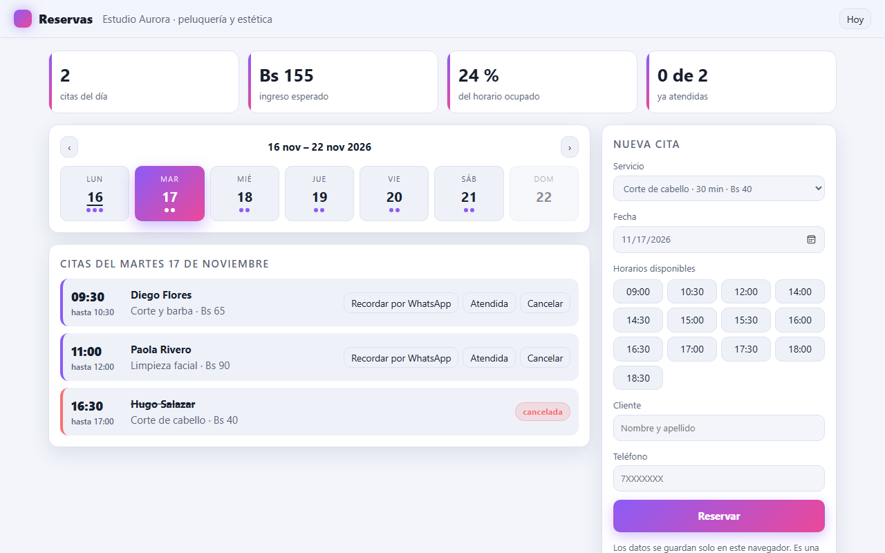

# Reservas — appointment booking

**[Try the live demo](https://chacolla2001-art.github.io/reservas/#demo)** · [Español](README.md)



Appointment scheduling for service businesses (salons, clinics, workshops): it shows only the slots that are really free, prevents double booking and prepares a WhatsApp reminder. It runs in the browser with no server.

## Features
- **Available slots** based on service duration, opening hours, the midday break and existing appointments.
- **No overlaps:** two appointments can never collide; a cancelled one frees its slot.
- **Weekly view** with busy days and the day's list sorted by time.
- **WhatsApp reminder:** one click opens a pre-written message for the client.
- **Daily summary:** appointments, expected revenue, share of the schedule that is booked, and how many were already attended.
- Past hours and closed days are never offered.

## How it is built
Plain HTML, CSS and JavaScript — no frameworks, no dependencies.
- `src/logica.js` holds the rules as pure functions: times are minutes since midnight and overlap is checked with half-open intervals `[start, end)`.
- `src/app.js` renders the UI and `src/datos.js` persists to `localStorage`.

```bash
npm test          # 11 tests: slots, overlap, validation and reminders
npm start         # opens the app at http://localhost:5181
```

Demo names and phone numbers are made up. The interface and identifiers are in Spanish.

MIT License.
