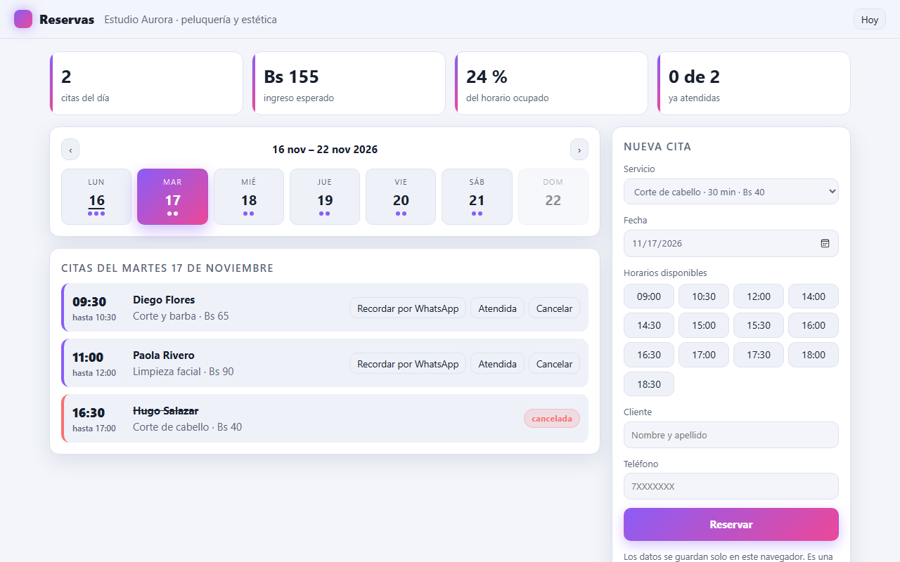

# Reservas — agenda de citas

**[Probar la demo en vivo](https://chacolla2001-art.github.io/reservas/#demo)** · [English](README.en.md)



Agenda de citas para negocios de servicios (peluquerías, consultorios, talleres): muestra solo los horarios realmente libres, evita la doble reserva y prepara el recordatorio por WhatsApp. Funciona en el navegador, sin servidor.

## Qué hace
- **Horarios disponibles** según la duración del servicio, el horario de atención, el descanso del mediodía y las citas ya tomadas.
- **Sin choques:** dos citas no pueden superponerse; una cita cancelada libera su espacio.
- **Vista semanal** con los días ocupados y la lista del día ordenada por hora.
- **Recordatorio por WhatsApp:** un clic abre el mensaje ya redactado para el cliente.
- **Resumen del día:** citas, ingreso esperado, porcentaje del horario ocupado y cuántas ya se atendieron.
- No ofrece horas que ya pasaron ni días cerrados.

## Cómo está hecho
HTML, CSS y JavaScript sin frameworks ni dependencias.
- `src/logica.js` tiene las reglas como funciones puras: las horas se manejan como minutos desde la medianoche y la superposición se comprueba con intervalos `[inicio, fin)`.
- `src/app.js` dibuja la pantalla y `src/datos.js` guarda en `localStorage`.

```bash
npm test          # 11 pruebas: horarios, superposición, validación y recordatorio
npm start         # abre la agenda en http://localhost:5181
```

Los nombres y teléfonos de la demostración son inventados.

## Para un negocio real
Para que los clientes reserven desde su teléfono hace falta una API con base de datos y avisos automáticos; esta versión cubre el uso interno en recepción.

Licencia MIT.
